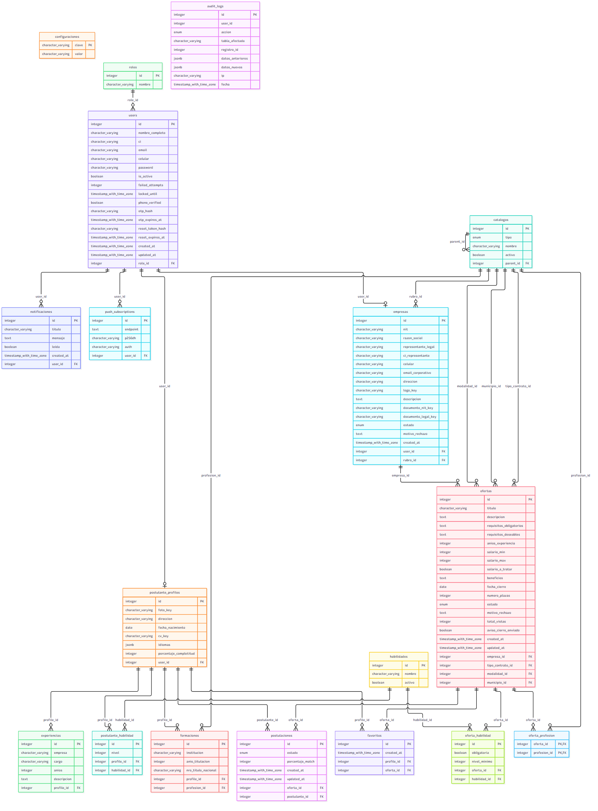

# Manual Técnico

**Bolsa de Trabajo Departamental Digital**, Gobierno Autónomo Departamental de Oruro.

## 1. Arquitectura

| Capa | Tecnología | Función |
|---|---|---|
| Interfaz | Vue 3, TypeScript, Tailwind, PWA | Pantallas responsive e instalables |
| API | NestJS 11, patrón MVC | Rutas, validación y reglas de negocio |
| Datos | PostgreSQL 16, TypeORM | 18 tablas, con migraciones y seeders |
| Archivos | Cloudflare R2, bucket privado | CV, fotos, logos y documentos |
| Avisos | SMTP, Web Push (VAPID) | Correo y notificaciones |

La interfaz y la API se comunican por HTTPS con JSON. Cada solicitud protegida lleva un JWT en la cabecera `Authorization: Bearer`.

Cada módulo de la API tiene `controller` (rutas), `service` (reglas), `dto` (validación) y `entities` (modelo).

## 2. Modelo de datos

- Script completo: [`database.sql`](database.sql)
- Diagrama: [`diagrama-er.png`](diagrama-er.png)
- Diccionario: [`diccionario-datos.md`](diccionario-datos.md)



## 3. Instalación local

Requiere Node.js 22.18 o superior y PostgreSQL 16.

**API**

```bash
git clone <repositorio-backend> && cd backend
npm install
cp .env.example .env
npm run migration:run
npm run seed
npm run seed:demo    # opcional
npm run start:dev
```

**Interfaz**

```bash
git clone <repositorio-frontend> && cd frontend
npm install
cp .env.example .env
npm run dev
```

## 4. Variables de entorno de la API

| Variable | Obligatoria | Descripción |
|---|---|---|
| `PORT` | No | Puerto de la API; por defecto 4000 |
| `FRONTEND_URL` | Sí | Origen permitido por CORS; varios separados por coma |
| `DB_HOST`, `DB_PORT`, `DB_USERNAME`, `DB_PASSWORD`, `DB_NAME` | Sí | Conexión a PostgreSQL |
| `JWT_SECRET` | Sí | Secreto largo y aleatorio |
| `JWT_EXPIRES_IN` | No | Duración de la sesión, por ejemplo `8h` |
| `ADMIN_EMAIL`, `ADMIN_PASSWORD` | Para el seed | SuperAdmin inicial |
| `DEMO_PASSWORD` | Para el seed demo | Contraseña de las cuentas de ejemplo |
| `R2_ACCOUNT_ID`, `R2_ACCESS_KEY_ID`, `R2_SECRET_ACCESS_KEY`, `R2_BUCKET` | Sí | Almacenamiento de archivos |
| `OTP_MODE` | No | `demo` muestra el código en pantalla |
| `SMTP_HOST`, `SMTP_PORT`, `SMTP_USER`, `SMTP_PASSWORD`, `SMTP_FROM` | Para correo | Sin ellas no se envían correos ni la recuperación de contraseña |
| `VAPID_PUBLIC_KEY`, `VAPID_PRIVATE_KEY`, `VAPID_SUBJECT` | Para push | Sin ellas no se envían notificaciones push |

Ninguna credencial se guarda en el repositorio: `.env` está excluido por `.gitignore` y `.env.example` solo contiene los nombres.

## 5. Despliegue con Coolify

Se crean tres recursos:

1. **PostgreSQL 16.** Base de datos administrada por Coolify.
2. **API.** Aplicación desde el repositorio `backend`, con Dockerfile, puerto 4000 y dominio, por ejemplo `api.dominio.bo`. Se cargan las variables de la sección 4, con `FRONTEND_URL` igual al dominio de la interfaz. Al iniciar, el contenedor aplica las migraciones pendientes.
3. **Interfaz.** Aplicación desde el repositorio `frontend`, con Dockerfile, puerto 80 y dominio, por ejemplo `bolsa.dominio.bo`. Se definen como variables de construcción `VITE_API_URL=https://api.dominio.bo/api` y `VITE_VAPID_PUBLIC_KEY`.

Tras el primer despliegue, en la terminal del contenedor de la API se ejecuta una sola vez:

```bash
npm run seed:prod
npm run seed:demo:prod    # opcional
```

Ambos dominios deben usar HTTPS: la instalación de la PWA y las notificaciones push lo exigen.

## 6. Seguridad

| Requisito | Implementación |
|---|---|
| Contraseñas | Bcrypt con costo 12; también para OTP y token de recuperación |
| Roles | Decorador `@Auth(...)` y guard que comprueba el rol en cada ruta |
| Bloqueo | 15 minutos tras 5 intentos fallidos |
| Validación backend | DTO con `class-validator`; se rechazan los campos no declarados |
| XSS | Vue escapa el contenido y no se usa `v-html`; Helmet agrega cabeceras |
| CSRF | El token va en una cabecera que el navegador no adjunta sola, por lo que un sitio ajeno no puede enviar solicitudes autenticadas |
| Abuso | Límite de solicitudes global y estricto en rutas de autenticación |
| Archivos | Bucket privado, URL firmadas temporales y comprobación del tipo real del archivo |
| Auditoría | Cambios de estado y su registro en la misma transacción |

## 7. Tareas programadas

Cada hora, la API busca las ofertas publicadas que cierran al día siguiente y avisa una sola vez a la empresa y a quienes la guardaron como favorita.

## 8. Mantenimiento

- **Cambiar el modelo:** modificar la entidad, ejecutar `npm run migration:generate`, revisar el archivo y aplicar con `npm run migration:run`.
- **Agregar un reporte:** añadir una entrada en la constante `REPORTES` de `src/reportes/reportes.service.ts` y un valor en `TipoReporte`.
- **Respaldo:** `pg_dump` periódico de la base de datos. Los archivos permanecen en R2.
