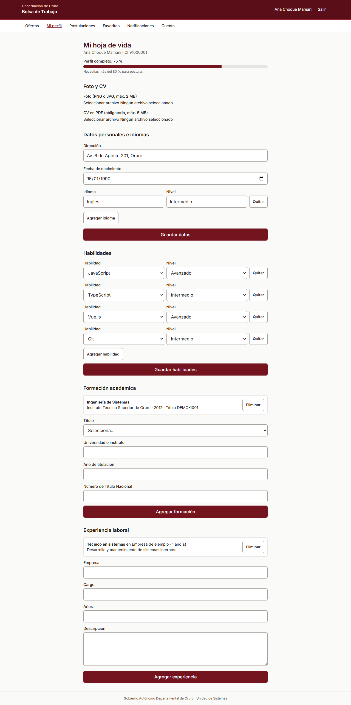
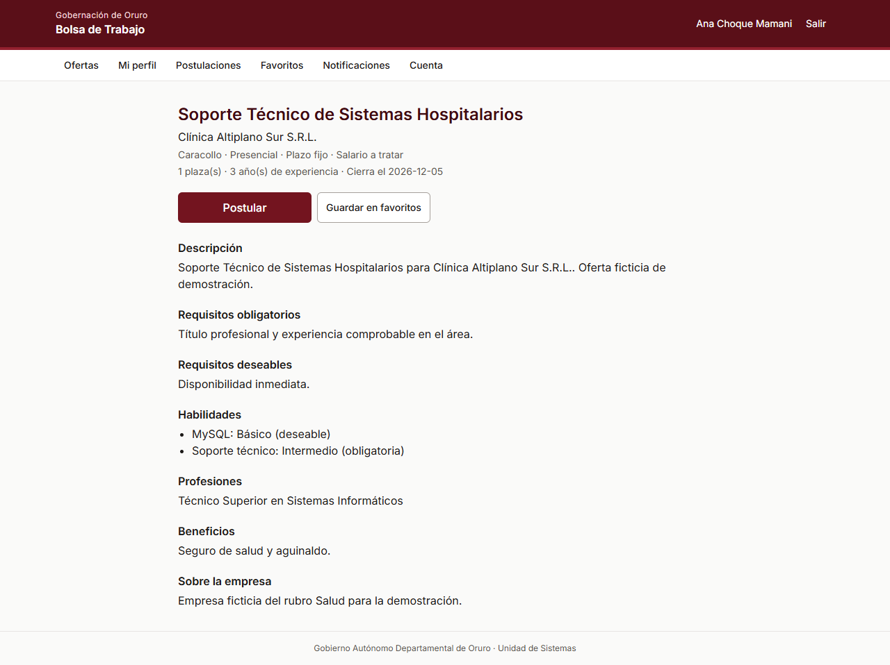
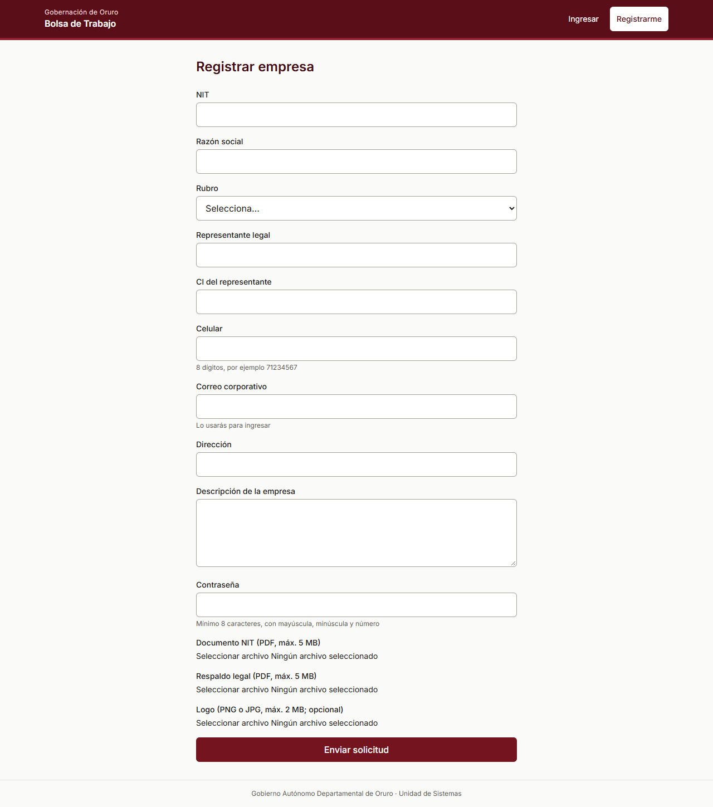
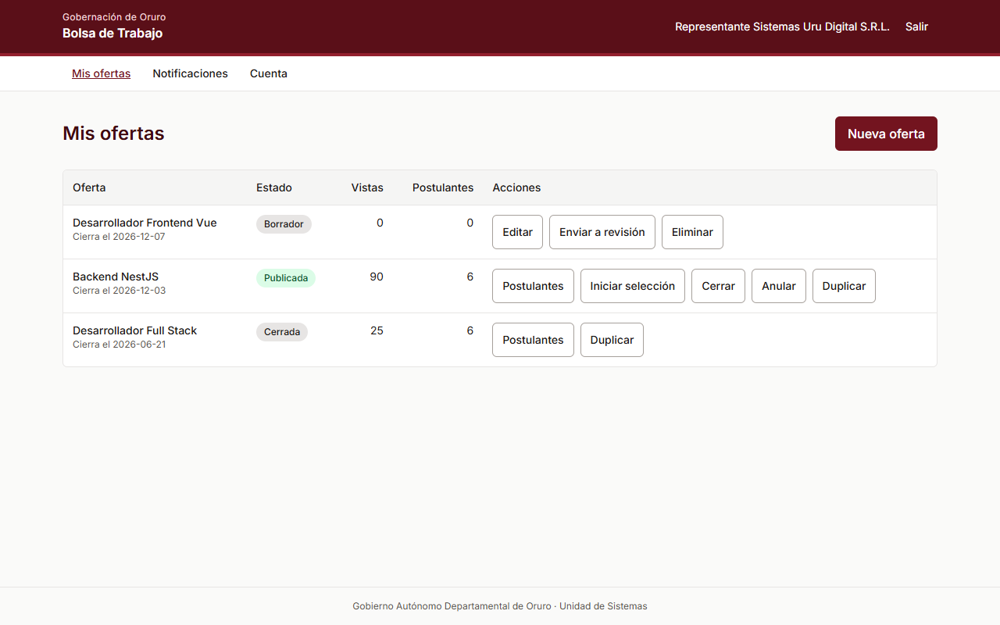
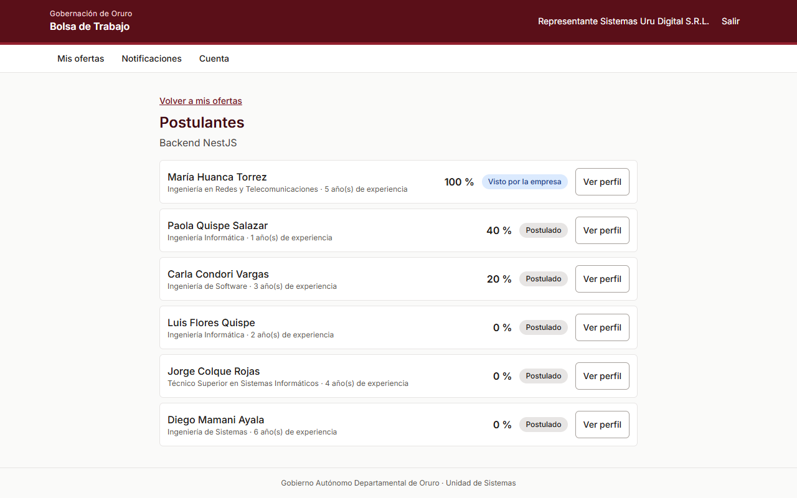
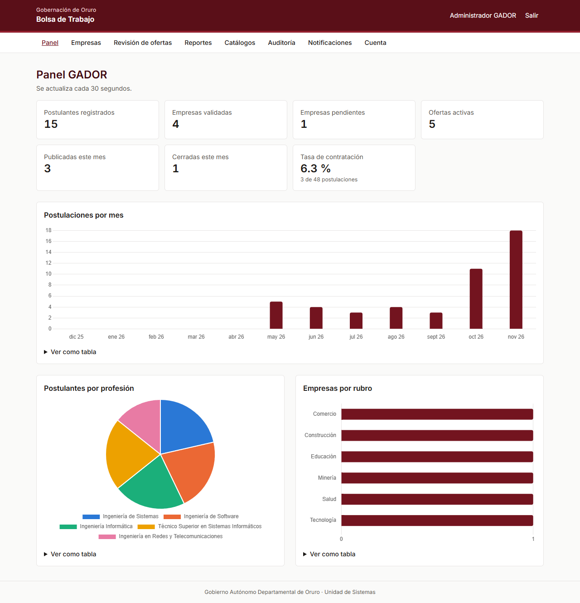
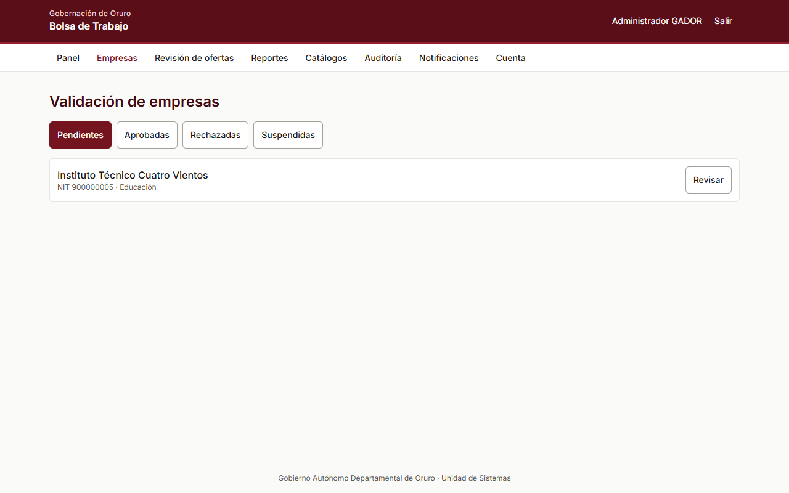
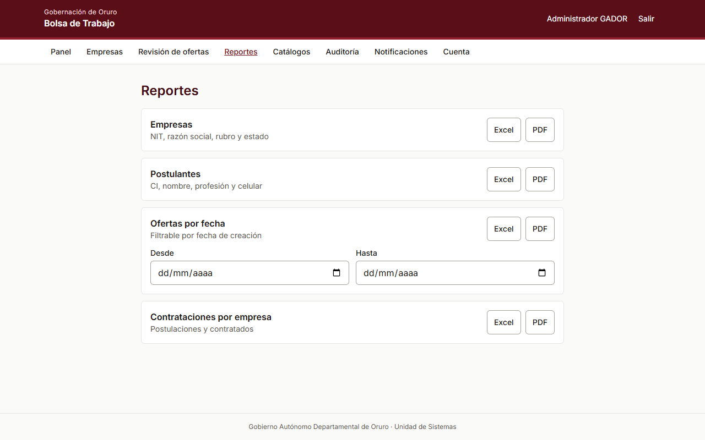
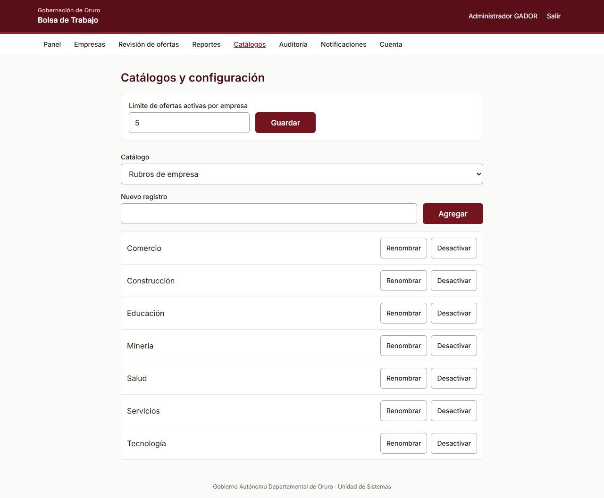
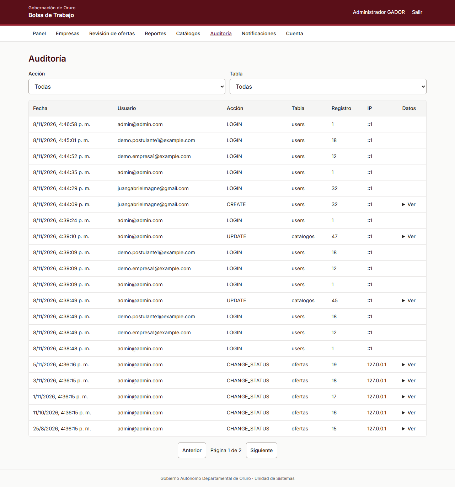

# Manual de Usuario

**Bolsa de Trabajo Departamental Digital**, Gobierno Autónomo Departamental de Oruro.

## Instalar la aplicación en el celular

1. Abre la dirección del sistema en Chrome para Android.
2. Abre el menú de Chrome y elige **Instalar aplicación** o **Agregar a la pantalla principal**.
3. Abre la aplicación desde el nuevo icono.

## Postulantes

### Crear tu cuenta

1. Elige **Registrarme** y completa CI, nombre, celular, correo y contraseña. La contraseña necesita al menos 8 caracteres, con mayúscula, minúscula y número.
2. Escribe el código de verificación de tu celular.

Tras 5 intentos fallidos de ingreso, la cuenta se bloquea 15 minutos. Si olvidaste la contraseña, usa **Olvidé mi contraseña** en la pantalla de ingreso.

### Completar tu hoja de vida

En **Mi perfil** registra datos personales, foto, formación, experiencia, habilidades, idiomas y tu CV en PDF (máximo 5 MB). El porcentaje indica cuánto has completado. **Para postular necesitas más del 80 %.**

### Buscar y postular

En **Ofertas** filtra por palabra clave, profesión, salario, ubicación y modalidad. Guarda las que te interesen como favoritas. Abre una oferta y pulsa **Postular**.

### Seguir tus postulaciones

En **Postulaciones** ves el estado y la fecha de cada una. Puedes retirar una postulación mientras la empresa no la haya visto.

## Empresas

### Registrar tu empresa

Elige **Soy una empresa** en la página de inicio y completa NIT, razón social, rubro, datos del representante, logo y documentos. Tu empresa queda **pendiente de validación** hasta que GADOR la apruebe. Recibirás un aviso con la decisión.

### Publicar ofertas

En **Mis ofertas** elige **Nueva oferta** y completa los datos. La oferta se guarda como **borrador**. Cuando esté lista, pulsa **Enviar a revisión**; GADOR la aprueba antes de publicarla. Solo los borradores se pueden editar. Para repetir una oferta usa **Duplicar**.

En el celular, desliza la tabla hacia un lado para ver las acciones.

### Elegir postulantes

En **Mis ofertas** pulsa **Postulantes**. La lista aparece ordenada por compatibilidad. Con **Ver perfil** abres su información y su CV, y el postulante recibe un aviso. Luego avanza cada candidato por las etapas: preseleccionado, entrevista, finalista y contratado, o recházalo.

## Administradores de GADOR

### Panel

**Panel** muestra los indicadores de postulantes, empresas, ofertas y contratación. Se actualiza cada 30 segundos.

### Validar empresas y ofertas

En **Empresas** revisa los documentos y aprueba, rechaza con motivo o suspende. En **Revisión de ofertas** aprueba la publicación o devuelve la oferta a borrador con un motivo.

### Reportes

En **Reportes** descarga, en Excel o PDF con membrete: empresas, postulantes, ofertas por fecha y contrataciones por empresa.

### Catálogos y configuración

En **Catálogos** agrega, renombra o desactiva rubros, profesiones, habilidades, tipos de contrato, modalidades, departamentos y municipios. Aquí también se define el límite de ofertas activas por empresa.

### Auditoría

En **Auditoría** consulta quién hizo cada acción, cuándo, desde qué IP y qué datos cambió.

## Para todos los usuarios

- **Notificaciones:** lista de avisos. Con **Activar en este dispositivo** también los recibes en el celular.
- **Cuenta:** permite cambiar la contraseña.
